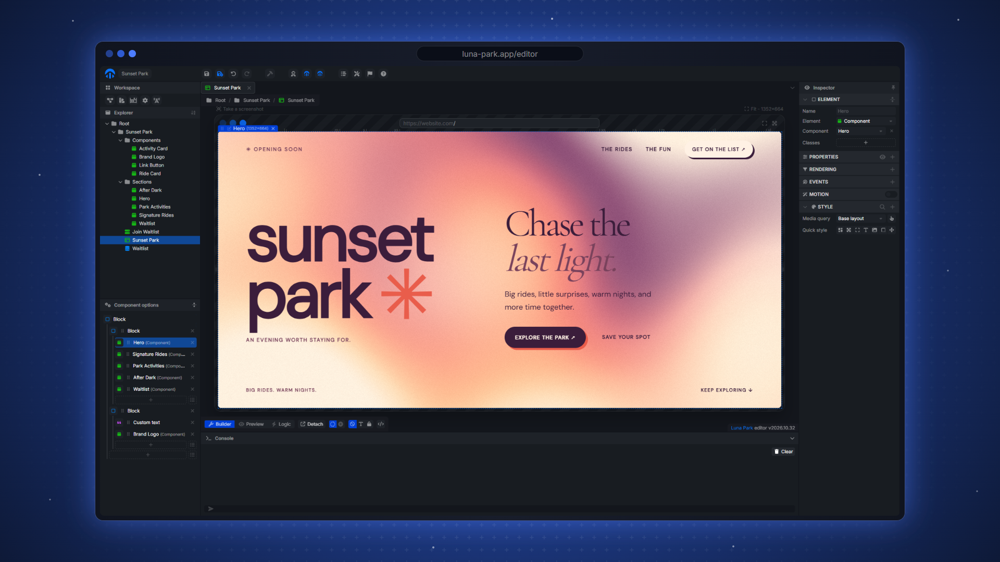
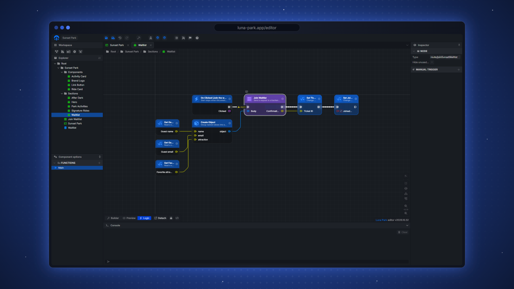
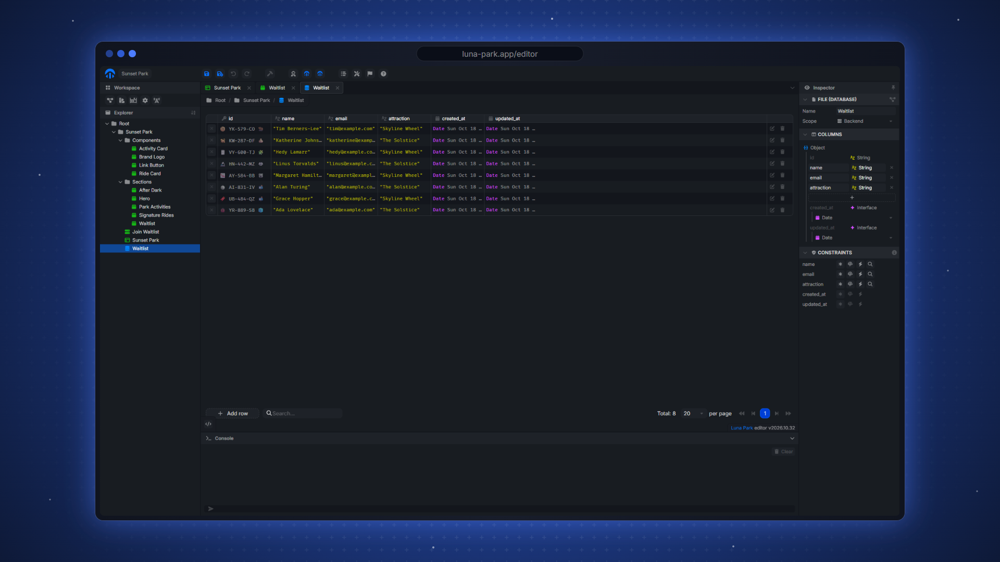
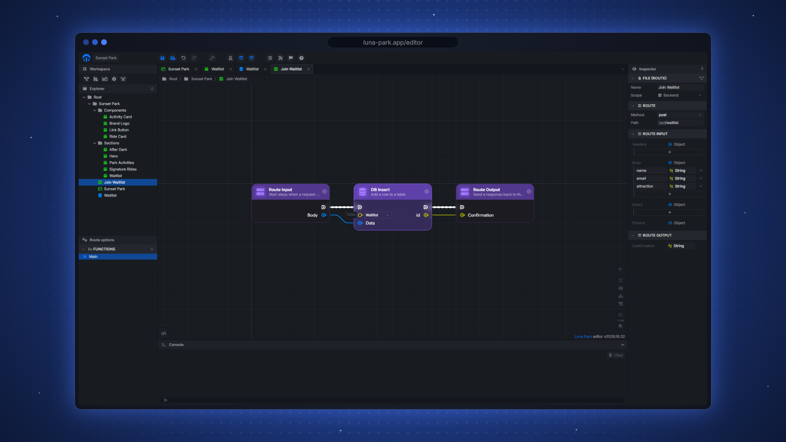

# 🎡 Welcome to Luna Park

[Luna Park](https://luna-park.app) is a visual development environment
for building full-stack web applications.

Build interfaces, connect application logic with nodes, manage state,
and create backend APIs and database queries—all in one workspace.
Work with familiar programming concepts such as variables, functions,
conditions, and loops through a visual editor.

### 🏗️ What can you build?

- Responsive pages and reusable Vue components
- Application logic and shared state
- Backend services and REST APIs
- PostgreSQL databases and visual queries

| Logic | Database | API route |
|---|---|---|
|  |  |  |

### 🔓 Your application, your code

Luna Park builds on Vue, Vite, Node.js, Fastify, and PostgreSQL.
Use npm packages and Vue component libraries, extend the editor with
plugins, and export your project as source code to host on your own
infrastructure, subject to your plan.

Optional AI assistance helps you create and refine your application,
while keeping changes visible and editable.

### 🚀 Get started

Open the [browser editor](https://luna-park.app/editor), or download the
desktop beta for Windows, macOS, or Linux from [luna-park.app](https://luna-park.app).
The desktop app can also build native apps for desktop, Android, and iOS.

- [Documentation](https://luna-park.app/docs/) — guides and technical reference
- [Interactive challenges](https://luna-park.app/challenge) — learn visual
  scripting through puzzles
- [Video academy](https://luna-park.app/academy) — guided courses
- [Education](https://luna-park.app/education) — resources for schools and workshops

### 🧩 Plugins

Extend Luna Park with components, visual nodes, and integrations.
Start from the [plugin boilerplate](https://github.com/lunapark/plugin-boilerplate)
and read the [plugin documentation](https://luna-park.app/docs/plugins).

### 📻 Community and feedback

Bug reports and feature requests live in [lunapark/lunapark](https://github.com/lunapark/lunapark).

- [Report a bug or suggest a feature](https://github.com/lunapark/lunapark/issues/new/choose)
- [Ask questions and share ideas](https://github.com/lunapark/lunapark/discussions)
- [Community forum](https://forum.luna-park.app/)
- [Join the community on Discord](https://discord.gg/2eAk2AHvdw)
